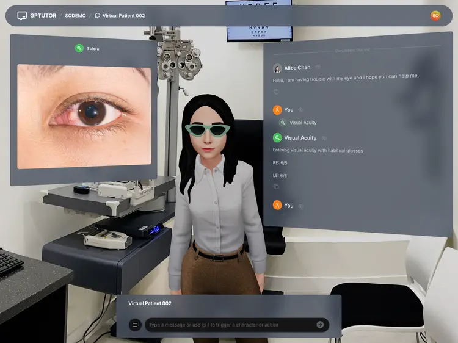
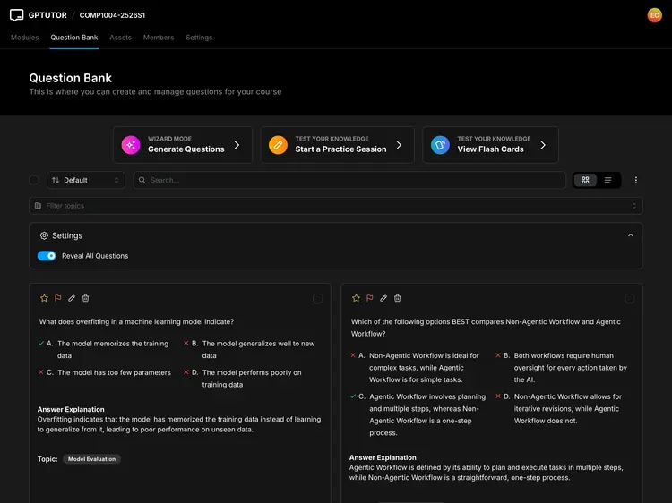
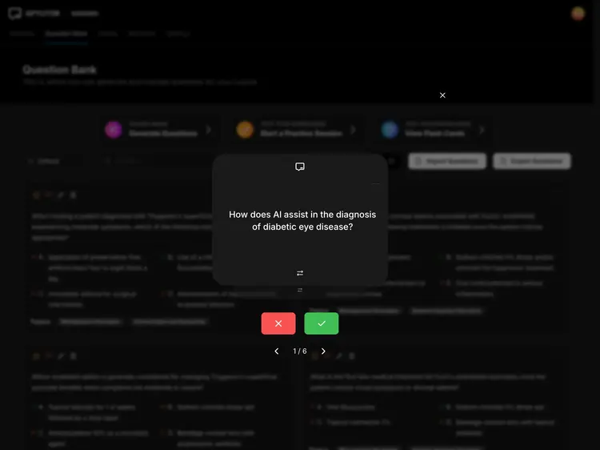
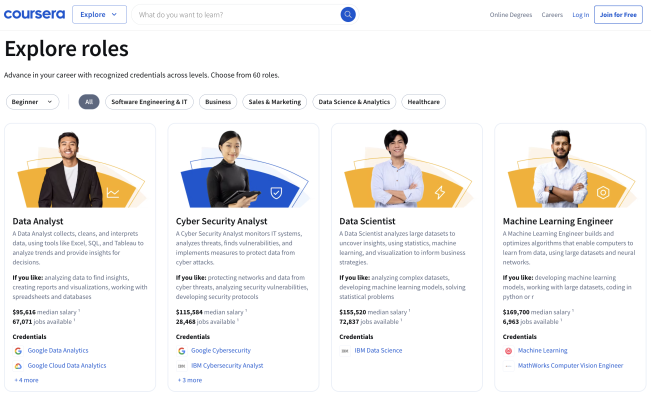

> 本文是 `competitor_analysis/README.md` 的中文译本。英文原版为准,两份需保持同步。

# 竞品分析：AI 赋能的学习平台

**调研日期：** 2026 年 9 月 12 日  
**调研方法：** 公开的产品页面与公开文档；未注册账号,也未访问任何私密的课程或学生数据。  
**目的：** 识别已被市场验证的产品范式,避免把现有平台做成一个通用复制品,并为 COMP5241 项目论证一个聚焦的 MVP。

> 证据边界：本次工作是桌面研究,而非用户研究。它识别出设计假设与竞品能力,但并不能证明我们的目标用户具有同样的需求。

## 1. 总体结论

市场上已经存在覆盖面很广的平台,涵盖 AI 辅导、课程创建、测验、模拟、游戏化和个性化推荐。若把这些功能全部重建一遍,我们的项目只会变得毫无特色、难以掌控。

因此,我们提出的产品应当聚焦于一个更窄的领域：

> **一个引导式的软件工程学习平台：教师创建经过审核的 AI 辅助迷你课程,学生通过自适应活动练习真实的职业技能——尤其是需求获取,以及如何有效使用 AI 编码 agent。**

我们的差异化不在于“我们也在用 AI”,而在于以下三点的组合：

1. 为软件工程学习者提供透明的下一步推荐；
2. 由教师掌控的 AI 课程创建,而非自动发布；以及
3. 结构化的需求获取角色扮演,用于评估学习者提问的质量。

---

## 2. 研究范围

| 平台 | 入选原因 | 所考察的证据 |
| --- | --- | --- |
| GPTutor | 项目任务书中提到的、与 PolyU 相关的 AI 学习平台；学生与教师工作流具有可比性。 | 公开主页以及官方的用户／教师文档。 |
| Coursera | 基于目标的内容发现与个性化推荐的成熟范例。 | 介绍推荐工作流的官方产品公告。 |
| Teachnow AI | 体现 AI 支持的路径、练习、进度以及教师课程创建的范例。 | 面向学习者与教师旅程的公开文档。 |
| EvoClass | 结构化 AI 素养学习内容的范例。 | 公开网站内容。 |

### 研究局限

- 我们没有注册账号、上传材料、报名课程,也没有访问任何非公开界面。
- 公开的产品页面描述的是其预期能力,并不能独立证明其可用性或学习效果。
- 查看时,Teachnow 的公开主页存在地区限制,但其公开文档仍可访问。我们只依据其文档了解已发布的工作流,不据此对产品在香港的实际运行表现作出判断。
- 下文提到的任何产品机会,都仍需通过原型加以验证。

---

## 3. 竞品证据

### 3.1 GPTutor —— 覆盖面广泛的 AI 课程与活动工具集

GPTutor 公开展示了文档对话、场景模拟、AI 出题、测验、闪卡、课程管理以及学生进度查看等功能。其教师文档描述了一套工作流：AI 生成的教程 draft 可以被编辑、预览、建立版本、发布,并通过学生的学习记录进行复盘。



*图 1。GPTutor 公开的场景模拟配图,截取自该平台 2026 年 9 月 12 日的公开功能页面。来源：[GPTutor](https://gptutor.comp.polyu.edu.hk/)。* 



*图 2。GPTutor 公开的出题功能配图。来源：[GPTutor](https://gptutor.comp.polyu.edu.hk/)。* 



*图 3。GPTutor 公开的测验／闪卡配图。来源：[GPTutor](https://gptutor.comp.polyu.edu.hk/)。* 

#### 我们的收获

- 对 AI 学习平台而言,互动活动（而不仅仅是静态内容）已是用户的普遍期待。
- AI 生成的学习材料在发布前应始终可编辑。
- 学习记录与活动作答情况可以为教师的后续决策提供依据。

#### 我们不会照搬的部分

GPTutor 刻意走的是“广”的路线。我们的项目不会去做文档对话、大量彼此无关的活动类型、通用素材库,或平台级的完整课程管理系统。

#### 我们 MVP 的设计决策

只实现**一个**精心设计的场景活动：用于练习需求获取的 AI 利益相关者角色扮演。并配套教师审核发布流程和基础的活动数据分析。

来源：[GPTutor 用户手册](https://gptutor.comp.polyu.edu.hk/user-guide)、[GPTutor 教程工作流](https://gptutor.comp.polyu.edu.hk/user-guide/tutorials/instructors)。

---

### 3.2 Coursera —— 以目标为导向、可解释的推荐

Coursera 在 2025 年的产品公告中描述了一条流程：学习者先完成一份简短的职业测评,随后获得一系列内容推荐和一项首要推荐,并能查看该推荐给出的理由。其明确目标是减少学习者在“接下来该学什么技能”上的不确定性。



*图 4。Coursera 公开的基于职业的内容发现配图,转载自其产品公告。来源：[Coursera Blog](https://blog.coursera.org/from-catalog-to-compass/)。* 

#### 我们的收获

- 一份引导问卷能把庞大的课程目录转化为一个易于迈出的第一步。
- 推荐应当可解释：学习者应当知道为什么接下来会出现这门课程或这个活动。
- “继续学习”和“首要推荐”比展示一堆权重相同的选项更具可操作性。

#### 我们不会照搬的部分

我们不会自建职业市场数据,不会支持数十种岗位角色,也不会声称采用了先进的推荐机器学习模型。

#### 我们 MVP 的设计决策

用三个透明的输入项——**背景**、**学习目标**和**最近的活动结果**——来推荐下一门迷你课程或下一个活动。并给出一句简短说明,例如：“推荐原因：你选择了 Git 入门,并且在分支活动中失分。”

来源：[Coursera: From Catalog to Compass](https://blog.coursera.org/from-catalog-to-compass/)。

---

### 3.3 Teachnow AI —— 清晰划分的学习者与教师旅程

Teachnow 的公开文档将学习者旅程（开始课程、跟随其 AI 导师学习、练习／测验、进度回顾、互动课程）与教师旅程（用 AI 搭建课程、准备活动、布置作业、评分与生成报告）分开描述。其教师文档明确说明,AI 撰写的课程方案需要先被阅读,然后才会发布。

#### 我们的收获

- 学生与教师的体验应当被视为两条独立而聚焦的流程,而不是挤在同一个信息过载的仪表盘里。
- 一个可用的课程生命周期应包含有意义的阶段：draft、审核／编辑、发布、学习者活动、进度回顾。
- 游戏化和直播教学可以是后续扩展,但并非 MVP 的必需项。

#### 我们不会照搬的部分

MVP 中不做直播课、支付、家长账号、学习世界游戏、证书或语音辅导。

#### 我们 MVP 的设计决策

只创建以下几种生命周期状态：

```text
AI draft -> Instructor edit -> Preview -> Publish -> Student attempt -> Instructor analytics
```

来源：[Teachnow 文档](https://www.teachnow.ai/docs)、[Teachnow 课程创建指南](https://www.teachnow.ai/docs/teach/create-a-course)。

---

### 3.4 EvoClass —— 把 AI 素养作为学习成果

EvoClass 公开提供一门结构化的 AI 素养课程,涵盖 AI 基础、GenAI/LLM、agent、人机协同创作以及伦理。

#### 我们的收获

与 AI 相关的学习平台应当教会学习者判断力和负责任的人机协作,而不只是鼓吹用 AI 实现自动化。

#### 我们 MVP 的设计决策

其中一门示例课程应为**《AI 编码 agent 的有效使用》**。它应要求学生评估 AI 的输出,并说明自己会去核实哪些内容,从而与课程的 AI Fluency 框架自然衔接。

来源：[EvoClass](https://evoclass.ai/)。

---

## 4. 能力矩阵与刻意划定的范围

图例：`✓` = 纳入 MVP；`△` = 收窄后的版本或后续迭代；`—` = 不在范围内。

| 能力 | GPTutor | Coursera | Teachnow | 我们项目的决策 | 理由 |
| --- | --- | --- | --- | --- | --- |
| 课程目录 | ✓ | ✓ | ✓ | ✓ | 报名和学习迷你课程所必需。 |
| 目标／背景引导 | △ | ✓ | ✓ | ✓ | 用于提供清晰的起点。 |
| AI 导师／通用聊天 | ✓ | ✓ | ✓ | — | 范围过宽、难以验证,且缺乏差异化。 |
| AI 课程生成 | ✓ | △ | ✓ | ✓ | 保留发布前的教师审核。 |
| AI 出题 | ✓ | △ | △ | ✓ | 仅生成可编辑的 draft。 |
| 测验与即时反馈 | ✓ | ✓ | ✓ | ✓ | 核心的互动学习活动。 |
| 场景模拟／角色扮演 | ✓ | △ | △ | ✓ | 将其打造成最具辨识度的软件工程活动。 |
| 学习进度分析 | ✓ | ✓ | ✓ | ✓ | 指标保持基础且能指导行动。 |
| 机器学习推荐系统 | △ | ✓ | △ | — | MVP 阶段改用透明规则替代。 |
| 语音／直播课／游戏化世界 | △ | △ | ✓ | — | 实现成本高,且与我们聚焦的问题契合度低。 |

---

## 5. 推导出的产品假设

以下是供原型测试使用的假设,而非已经验证的结论。

| 编号 | 假设 | 原型功能 | 验证任务 |
| --- | --- | --- | --- |
| H-01 | 相比长长的课程列表,初学者更需要一个清晰的起点。 | 引导流程 + 一门推荐的迷你课程。 | 请一名参与者在无人协助的情况下自行找到合适的第一门课程。 |
| H-02 | 学习者在答错之后需要解释和下一步行动指引。 | 带解释的反馈卡片 + 下一步推荐。 | 询问参与者在答错之后会怎么做。 |
| H-03 | 只有在能够先编辑和预览的情况下,教师才会信任 AI 生成的课程内容。 | AI draft -> 编辑 -> 预览 -> 发布流程。 | 请一位教师／助教创建一门课程,并说出其在信任方面的顾虑。 |
| H-04 | 完成率、常见错误和不活跃情况,比多种图表类型更能指导行动。 | 教师端分析摘要。 | 询问哪个数据点会改变教师接下来的行动。 |
| H-05 | 相比只做 MCQ,模拟的利益相关者对话能更有意义地练习需求获取。 | 受控的 AI 角色扮演 + 提问质量评分量表。 | 比较学习者第一次与修改后的提问表现。 |

---

## 6. MVP 决策的可追溯性

| 研究洞察 | 需求／功能决策 |
| --- | --- |
| 覆盖面广的工具已提供通用聊天、多种活动和文档问答。 | 不做通用聊天机器人；专注于软件工程学习活动。 |
| 面向教师的产品都依赖一份在发布前经过审核的 AI draft。 | 实现 Draft、Preview、Published 三种状态；不允许 AI 自动发布。 |
| 个性化平台会询问学习者的目标,并给出清晰的下一步行动。 | 增加简短的引导流程,以及可解释的下一步推荐。 |
| 模拟可以让学习变得更具互动性。 | 实现一个需求获取角色扮演,并配套一份范围很窄的评分量表。 |
| 教师需要依据进度数据采取行动。 | 展示完成率、常见错误答案和不活跃学习者名单,而不是一套复杂的分析系统。 |

---

## 7. 推荐的下一步

基于这项研究,制作两条可点击的 Figma 流程：

1. **学生：** 引导 -> 推荐的 Git/AI 编码 agent 迷你课程 -> 课时 -> MCQ 或角色扮演 -> 反馈 -> 下一步。
2. **教师：** 描述课程 -> AI draft -> 编辑 -> 预览 -> 发布 -> 查看完成情况／常见错误。

团队完成初版原型后,邀请 2-3 位组外人员开展简短的任务型测试。用实际观察结果和设计变更更新假设表。不要把桌面研究或组内角色扮演称为外部用户反馈。
